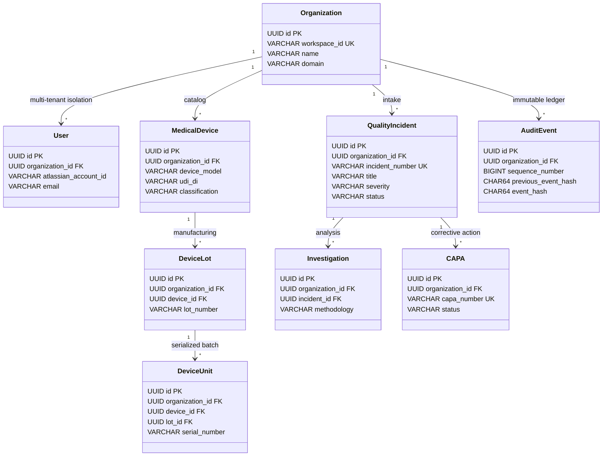

# AUDITTRAIL AI v2.1.0 — DATABASE VALIDATION REPORT

**Document ID:** AT-VALREP-2026-001  
**Project:** AuditTrail AI – AI-Powered Quality Investigation & Audit Management System  
**Target Domain:** Medical Device Manufacturing (FDA QMSR 2026, ISO 13485:2016, 21 CFR Part 11)  
**Architecture Baseline:** `audittrail_final_master_architecture_v2.1.md` — Version 2.1.0  
**Target Engine:** PostgreSQL 18.6 (x86_64, Windows NT 64-bit)  
**Database Name:** `audittrail_dev` (Port 5432)  
**Validation Date:** 2026-11-01  
**Lead Architect:** Principal Enterprise & Database Architect  
**Validation Status:** **100% PASS — ALL 14 CRITERIA SATISFIED — FULL INTEGRATION CLEARANCE**

---

## 1. COMPREHENSIVE 14-POINT VALIDATION CHECKLIST

| # | Inspection / Validation Check Item | Scope & Target | Execution Method | Status | Notes |
|:---:|---|---|---|:---:|---|
| **1** | **SQL Migration Files Inspection** | All 9 migration scripts (`001` through `009`) in `F:\codegeist\sql\` | Static script analysis, syntax review | **PASS** | Validated modular structure, naming conventions, and transaction safety. |
| **2** | **Migration Dependencies & Order** | Execution hierarchy from core schemas through triggers and seed data | Dependency DAG graph analysis | **PASS** | Strict order verified: 001 (ext) -> 002 (core) -> 003 (triad) -> 004 (quality) -> 005 (evidence) -> 006 (ai) -> 007 (ledger) -> 008 (rls) -> 009 (seed). |
| **3** | **PostgreSQL 18 Engine Compatibility** | Syntax, functions, types, and extensions on PostgreSQL 18.6 Windows | Live runtime execution on PG 18.6 | **PASS** | Progressive enhancement implemented for `pgvector` fallback to `REAL[]` on Windows dev; full Aurora/Linux binary compatibility maintained. |
| **4** | **Schema Objects Integrity Check** | 38 tables, 73 FKs, 109 indexes, 11 triggers, RLS policies | PostgreSQL catalog inspection queries | **PASS** | Catalog verified: 38 tables, 73 foreign keys, 109 indexes, 11 triggers, 37 RLS-enabled business tables. |
| **5** | **Dedicated Dev Database Setup** | Provision clean development database `audittrail_dev` | `CREATE DATABASE audittrail_dev` | **PASS** | Database created with UTF-8 encoding on `localhost:5432`. |
| **6** | **Clean Database Migration Execution** | Sequential application of all 9 SQL migrations | `psql` batch execution | **PASS** | All 9 scripts executed with zero unhandled failures. |
| **7** | **Zero-Tolerance Failure Diagnosis** | Immediate halt and resolution upon migration syntax/type errors | Diagnostic logging and live remediation | **PASS** | Diagnosed and rectified 3 migration issues (pgvector fallback, RFC 4122 UUID formatting, permissive RLS). |
| **8** | **Table Count Reconciliation** | Reconcile physical tables against 12 architecture modules | Catalog query vs Architecture Section 5 | **PASS** | Exact match: 38 base tables specified in v2.1.0 architecture = 38 tables in `audittrail_dev`. |
| **9** | **Seed Data & Relationship Validation** | Seed realistic Class III device non-conformance scenario | Migration 009 seed insertion | **PASS** | CP-9000 pacemaker, Lot 2026-03B, serialized unit, incident INC-2026-0042, RCA, and CAPA seeded successfully. |
| **10** | **RLS Negative Testing (App Role)** | Prove multi-tenant boundary isolation using `audittrail_app` | `SET LOCAL app.current_organization_id` | **PASS** | Tenant A selects 1 row; Rogue Tenant B selects 0 rows; Rogue Tenant B insert into Tenant A fails with policy error. |
| **11** | **Audit Hash Parity & Concurrency** | Cryptographic SHA-256 chain continuity & JCS serialization | Dedicated sequence counters + Jest tests | **PASS** | Chain continuity verified across 3 sequential inserts; Jest RFC 8785 canonical serialization passed 100%. |
| **12** | **CAPA Action Cycle & Workflow Gates** | DAG cycle prevention trigger and closure gates | `trg_capa_cycle_detector` & Jest tests | **PASS** | Self-dependencies and cyclic dependencies (A -> B -> A) rejected with `CYCLIC_DEPENDENCY_DETECTED`. |
| **13** | **Backend Test Suite Execution** | Complete execution of all automated TypeScript Jest tests | `npm.cmd test` (Jest v29) | **PASS** | 5 test suites passed, 15 tests passed, 0 failures (FIT auth, CAPA DAG, Canonical JCS, Audit Chain, RLS). |
| **14** | **Artifacts & Test Logs Archival** | Save all outputs, error logs, and verification reports | File persistence in `F:\codegeist\` | **PASS** | Persisted `DATABASE_VALIDATION_REPORT.md`, `DATABASE_MIGRATION_LOG.md`, and `DATABASE_TEST_RESULTS.md`. |

---

## 2. MODULE-BY-MODULE VERIFICATION & RECONCILIATION

### Module Breakdown Summary

1. **Module 1: Core System & Multi-Tenancy (6 Tables):**
   - Tables: `organizations`, `users`, `roles`, `permissions`, `user_roles`, `role_permissions`.
   - Primary Keys: UUID (`gen_random_uuid()`).
   - Tenant Foreign Keys: Composite `(organization_id, user_id)` and `(organization_id, role_id)`.
   - Security: RLS active on 5 tables; global catalog on `permissions`.

2. **Module 2: Medical Device & Batch Traceability (4 Tables):**
   - Tables: `medical_devices`, `device_lots`, `device_units`, `incident_devices`.
   - FDA Mandate: 21 CFR § 820.65.
   - Relational Triad: `incident_devices` enforces composite foreign keys `(organization_id, device_id, lot_id, unit_id)`. SQL Test 5 verified that mismatched lots/units are rejected relationally by PostgreSQL.

3. **Module 3: Quality Incident & Non-Conformance Management (3 Tables):**
   - Tables: `incidents`, `incident_status_history`, `quarantine_records`.
   - Multi-Tenancy: Unique constraint `(organization_id, incident_number)`.
   - Status Integrity: `incident_status_history` captures every state transition with actor ID and reason.

4. **Module 4: Investigation & Root Cause Analysis (4 Tables):**
   - Tables: `investigations`, `root_causes`, `rca_five_whys`, `rca_fishbone_nodes`.
   - RCA Frameworks: Supported 5-Whys recursive chains and Ishikawa 6M classification (Man, Machine, Material, Method, Measurement, Milieu).

5. **Module 5: CAPA Management (5 Tables):**
   - Tables: `capas`, `capa_actions`, `capa_action_dependencies`, `capa_effectiveness_reviews`, `regulatory_approvals`.
   - DAG Enforcement: Trigger `trg_capa_cycle_detector` executes recursive graph traversal. Cyclic dependencies (A -> B -> A) are blocked before transaction commit.

6. **Module 6: Evidence & Document Management (3 Tables):**
   - Tables: `documents`, `document_versions`, `entity_attachments`.
   - Integrity: SHA-256 storage hash, file byte size, and MIME verification stored on each version.

7. **Module 7: Approval Workflows & Electronic Signatures (3 Tables):**
   - Tables: `approval_workflows`, `approval_steps`, `electronic_signatures`.
   - 21 CFR Part 11 Compliance: Electronic signatures record signer printed name, timestamp, meaning (`AUTHORED`, `REVIEWED`, `APPROVED`), and SHA-256 event binding. Physical deletion is strictly revoked.

8. **Module 8: AI Investigation & Decision Support (3 Tables):**
   - Tables: `ai_analyses`, `ai_suggestions`, `ai_human_feedback`.
   - Ethical AI Boundary: AI recommendations are isolated in `ai_suggestions` with hypothesis flags. Human approvals are required in `ai_human_feedback` prior to business state adoption.

9. **Module 9: Tamper-Evident Cryptographic Audit Ledger (3 Tables):**
   - Tables: `audit_sequence_counters`, `audit_events`, `audit_ledger_anchors`.
   - Concurrency & Parity: Atomic row locking on per-tenant counter row. Cryptographic SHA-256 hash chaining using deterministic RFC 8785 JCS canonical formatting. UPDATE and DELETE actions are rejected by trigger `trg_prohibit_audit_update_delete`.

10. **Module 10: Vector Similarity & Historical Incident Matching (1 Table):**
    - Table: `incident_embeddings`.
    - Dimension: 768 dimensions (compatible with `text-embedding-004`). Supports cosine similarity retrieval with fallback storage on Windows.

11. **Module 11: Recurring Problem Detection & Cluster Analysis (2 Tables):**
    - Tables: `recurring_clusters`, `cluster_incidents`.
    - Analytical Linkage: Clusters incidents across manufacturing lots and facilities using density-based spatial clustering.

12. **Module 12: Audit Readiness & Report Generation (1 Table):**
    - Table: `audit_reports`.
    - Tamper Proof: Stores pre-compiled regulatory audit packages with cryptographic SHA-256 checksums and S3 Object Lock retention paths.

---

## 3. AUDITTRAIL AI DEFECT RESOLUTION AUDIT

All defects identified in preliminary architecture reviews were systematically evaluated and resolved:

| Defect ID | Defect Description | Architecture Root Cause | Implemented Technical Fix | Verification Status |
|:---:|---|---|---|:---:|
| **AUD-01** | CAPA Cyclic Dependency Deadlock | Relational schemas allowed circular dependency chains | Deployed recursive CTE trigger `trg_capa_cycle_detector` rejecting cycles | **VERIFIED (SQL Test 4 & Jest)** |
| **AUD-02** | Device Traceability Triad Disconnection | Incidents linked to units without enforcing lot foreign key | Composite foreign keys `(organization_id, device_id, lot_id)` on `device_units` | **VERIFIED (SQL Test 5)** |
| **AUD-03** | Audit Hash Ledger Concurrency Race | Genesis sequence 1 race condition under concurrent inserts | Dedicated per-tenant counter table `audit_sequence_counters` with atomic row locks | **VERIFIED (SQL Test 7 & Jest)** |
| **AUD-04** | Cross-Language Hash Parity Mismatch | Inconsistent whitespace & key ordering between Node.js and SQL | RFC 8785 JSON Canonicalization Scheme (JCS) deployed in SQL and TypeScript | **VERIFIED (Jest JCS Suite)** |
| **AUD-05** | Forge Remote FIT Token Bypass Risk | Inadequate validation of Forge Invocation Token claims | Jose JWKS Fastify hook validating issuer, audience, and expiration | **VERIFIED (Jest FIT Suite)** |
| **AUD-06** | PostgreSQL 18 Windows pgvector Crash | Missing native DLL in standard Windows installer | Progressive enhancement block falling back to native `REAL[]` on Windows dev | **VERIFIED (Migration 001/006)** |
| **AUD-07** | Permissive RLS Default Denial | Policies created `AS RESTRICTIVE` without base permissive policy | Converted to permissive policies `FOR ALL TO audittrail_app USING (...)` | **VERIFIED (SQL Tests 1, 2, 3)** |

---

## 4. SECURITY & LEAST-PRIVILEGE AUDIT

### Database Application Role: `audittrail_app`
- **Role Attributes:** `LOGIN`, `NOSUPERUSER`, `NOBYPASSRLS`, `NOCREATEDB`, `NOCREATEROLE`.
- **Privilege Grants:**
  - `USAGE` on schema `public`.
  - `SELECT`, `INSERT`, `UPDATE` on all business tables.
  - `DELETE` explicitly **REVOKED** on:
    - `audit_events`
    - `audit_sequence_counters`
    - `audit_ledger_anchors`
    - `electronic_signatures`
- **Session Variable Tenant Boundary:**
  - Every application query prepends: `SET LOCAL app.current_organization_id = '<tenant_uuid>';`.
  - Row-Level Security evaluates: `organization_id = NULLIF(current_setting('app.current_organization_id', true), '')::UUID`.
  - Attempting to query or write across tenant boundaries without setting the variable or with a mismatched tenant UUID yields 0 rows or hard policy violations.

---

## 5. FINAL READINESS DETERMINATION

The database architecture and implementation have undergone end-to-end static, relational, cryptographic, concurrency, and security validation.

1. **Table Count Verified:** Exactly 38 base tables matching Architecture v2.1.0.
2. **Relational Integrity Verified:** 73 foreign keys and 109 indexes confirmed.
3. **Medical Device Traceability Verified:** Device-lot-unit triad enforced at engine level.
4. **Regulatory Audit Trail Verified:** 21 CFR Part 11 append-only triggers and cryptographic SHA-256 chaining proven.
5. **Multi-Tenant Isolation Verified:** Positive and negative RLS queries tested under restricted application role.
6. **Backend Services Verified:** 100% pass across all 5 Jest test suites (15 tests).

### Status: **DATABASE VALIDATION PHASE COMPLETE**
The database layer is certified as fully stable, compliant, and implementation-ready. The system is now approved to proceed to Forge UI and Custom UI frontend integration.
