# AUDITTRAIL AI — FINAL MASTER ARCHITECTURE SPECIFICATION
## Version 2.1.0 — Production-Oriented Technical Architecture

**Classification:** Medical Device eQMS Architecture Specification  
**Regulatory Baseline:** FDA QMSR (effective Feb 2, 2026 / 21 CFR Part 820), ISO 13485:2016, FDA 21 CFR Part 11, EU MDR 2017/745 (Annex IX & VI), HIPAA / GDPR (Data Minimization)  
**Platform Ecosystem:** Atlassian Forge (Custom UI + Forge Remote) + External Managed PostgreSQL 15+ (`pgvector`) on AWS/Cloud Run + S3 Compliance WORM  

---

## 1. Executive Summary

**AuditTrail AI** is an enterprise AI-assisted Electronic Quality Management System (eQMS) built specifically for Medical Device Manufacturers. It integrates regulatory quality workflows natively into Atlassian Jira and Confluence Cloud while strictly preserving clinical safety boundaries through a **Human-in-the-Loop** model: AI acts as an investigative assistant generating non-binding hypotheses, but is relationally and architecturally prohibited from making unilateral quality decisions.

### Version 2.1.0 Architectural Milestones
1. **Forge Remote Integration Validated:** Replaced direct PostgreSQL TCP assumptions with an official Forge Remote Fastify backend utilizing Forge Invocation Token (FIT) asymmetric JWT verification against official Atlassian JWKS endpoints.
2. **Reconciled 38-Table Relational Schema:** Eliminated all table count contradictions; modularized into 11 modules and 38 strictly typed tables with composite foreign keys `(organization_id, parent_id)` to mathematically eliminate cross-tenant data traversal.
3. **Concurrency-Safe Audit Ledger:** Solved genesis concurrency race conditions via a pre-seeded `audit_sequence_counters` table and enforced RFC 8785 (JSON Canonicalization Scheme - JCS) to guarantee byte-for-byte SHA-256 hash parity between database triggers and TypeScript services.
4. **Vertex AI 768-Dimension Standardization:** Standardized on Google Vertex AI `text-embedding-004` (768 dimensions) with native HNSW cosine distance indexing (`m=16, ef_construction=64`).
5. **FDA QMSR 2026 Harmonization:** Updated regulatory mappings to the FDA's finalized Quality Management System Regulation (QMSR), which took effect February 2, 2026, aligning with ISO 13485:2016 Clauses 8.5.2 & 8.5.3.

---

## 2. System Architecture & Component Responsibilities

```
┌────────────────────────────────────────────────────────────────────────┐
│                        Atlassian Cloud Platform                        │
│  ┌───────────────────────┐                  ┌───────────────────────┐  │
│  │      Jira Cloud       │                  │   Confluence Cloud    │  │
│  └───────────┬───────────┘                  └───────────┬───────────┘  │
│              │                                          │              │
│              └────────────────────┬─────────────────────┘              │
│                                   ▼                                    │
│                 ┌───────────────────────────────────┐                  │
│                 │ Forge Custom UI (React / Atlaskit)│                  │
│                 └─────────────────┬─────────────────┘                  │
│                                   │ requestRemote()                     │
│                                   ▼                                    │
│                 ┌───────────────────────────────────┐                  │
│                 │   Atlassian Forge Remote Layer    │                  │
│                 │  (Signs Outbound Requests w/ FIT) │                  │
│                 └─────────────────┬─────────────────┘                  │
└───────────────────────────────────┼────────────────────────────────────┘
                                    │ HTTPS (TLS 1.3)
                                    │ Authorization: Bearer <FIT-JWT>
                                    ▼
┌────────────────────────────────────────────────────────────────────────┐
│               Dedicated Microservices Layer (AWS Fargate)              │
│  ┌──────────────────────────────────────────────────────────────────┐  │
│  │ Fastify / Node.js API Gateway                                    │  │
│  │ - FIT Signature Verification (jose / Atlassian JWKS)             │  │
│  │ - Tenant Context Isolation (SET LOCAL app.current_organization_id)│  │
│  │ - DAG Cycle Detector for CAPA Action Dependencies                │  │
│  │ - RFC 8785 JCS Canonical Hash Computation                        │  │
│  └───────────────────┬──────────────────────────┬───────────────────┘  │
└──────────────────────┼──────────────────────────┼──────────────────────┘
                       │ TCP 5432 (Internal VPC)  │ HTTPS (S3 API)
                       ▼                          ▼
┌──────────────────────────────────────┐  ┌──────────────────────────────┐
│ AWS Aurora PostgreSQL 15+ Cluster    │  │ AWS S3 Compliance WORM Bucket│
│ - PgBouncer (Transaction Mode)       │  │ - S3 Object Lock (Compliance)│
│ - 38 Relational Tables (Strict 3NF)  │  │ - Retention: Device Life + 2Y│
│ - pgvector (text-embedding-004 768d) │  │ - Evidence PDF / Image Vault │
│ - Cryptographic Hash Chain Triggers  │  │ - Hourly Merkle Ledger Proofs│
│ - Restrictive RLS on all Tenant Data │  └──────────────────────────────┘
└──────────────────────────────────────┘
```

---

## 3. Complete Reconciled Database Inventory (11 Modules, 38 Tables)

| Module # | Functional Module | Total Tables | Table Names |
| :--- | :--- | :---: | :--- |
| **M1** | Tenant & RBAC | 6 | `organizations`, `users`, `roles`, `permissions`, `role_permissions`, `user_roles` |
| **M2** | Medical Device Traceability | 4 | `medical_devices`, `regulatory_approvals`, `device_lots`, `device_units` |
| **M3** | Incident & Non-Conformance | 4 | `incidents`, `incident_devices`, `quarantine_records`, `incident_status_history` |
| **M4** | Investigation & RCA | 4 | `investigations`, `rca_five_whys`, `rca_fishbone_nodes`, `root_causes` |
| **M5** | CAPA Lifecycle Engine | 4 | `capas`, `capa_actions`, `capa_action_dependencies`, `capa_effectiveness_reviews` |
| **M6** | Evidence & Document Vault | 3 | `documents`, `document_versions`, `entity_attachments` |
| **M7** | Approvals & E-Signatures | 3 | `approval_workflows`, `approval_steps`, `electronic_signatures` |
| **M8** | AI Intelligence Governance | 4 | `ai_analyses`, `ai_suggestions`, `ai_human_feedback`, `incident_embeddings` |
| **M9** | Tamper-Evident Ledger | 3 | `audit_sequence_counters`, `audit_events`, `audit_ledger_anchors` |
| **M10**| Recurring Analytics | 2 | `recurring_clusters`, `cluster_incidents` |
| **M11**| Inspection Readiness Reports| 1 | `audit_reports` |
| **TOTAL**| **Reconciled Inventory** | **38** | **Strictly verified across SQL migration scripts 001 through 008** |

---

## 4. Entity Relationship Diagram (Mermaid)

```mermaid
erDiagram
    ORGANIZATIONS ||--o{ USERS : "employs"
    ORGANIZATIONS ||--o{ ROLES : "defines"
    ORGANIZATIONS ||--o{ MEDICAL_DEVICES : "manufactures"
    ORGANIZATIONS ||--o{ INCIDENTS : "intakes"
    ORGANIZATIONS ||--o{ CAPAS : "governs"
    ORGANIZATIONS ||--o{ DOCUMENTS : "vaults"
    ORGANIZATIONS ||--|| AUDIT_SEQUENCE_COUNTERS : "tracks_sequence"
    ORGANIZATIONS ||--o{ AUDIT_EVENTS : "records"
    ORGANIZATIONS ||--o{ AUDIT_LEDGER_ANCHORS : "anchors"

    USERS ||--o{ USER_ROLES : "assigned"
    ROLES ||--o{ USER_ROLES : "held_by"
    ROLES ||--o{ ROLE_PERMISSIONS : "aggregates"
    PERMISSIONS ||--o{ ROLE_PERMISSIONS : "granted_to"

    MEDICAL_DEVICES ||--o{ REGULATORY_APPROVALS : "cleared_under"
    MEDICAL_DEVICES ||--o{ DEVICE_LOTS : "manufactured_in"
    DEVICE_LOTS ||--o{ DEVICE_UNITS : "serialized_into"

    INCIDENTS ||--o{ INCIDENT_DEVICES : "implicates"
    DEVICE_UNITS ||--o{ INCIDENT_DEVICES : "unit_affected"
    DEVICE_LOTS ||--o{ INCIDENT_DEVICES : "lot_affected"
    INCIDENTS ||--o{ QUARANTINE_RECORDS : "triggers_hold"
    INCIDENTS ||--o{ INCIDENT_STATUS_HISTORY : "transitions"
    INCIDENTS ||--o| INVESTIGATIONS : "analyzed_in"
    INCIDENTS ||--o{ INCIDENT_EMBEDDINGS : "vectorized_into"

    INVESTIGATIONS ||--o{ RCA_FIVE_WHYS : "executes"
    INVESTIGATIONS ||--o{ RCA_FISHBONE_NODES : "categorizes"
    INVESTIGATIONS ||--o{ ROOT_CAUSES : "confirms"
    INVESTIGATIONS ||--o{ CAPAS : "escalates_to"

    CAPAS ||--o{ CAPA_ACTIONS : "specifies"
    CAPA_ACTIONS ||--o{ CAPA_ACTION_DEPENDENCIES : "prerequisite_of"
    CAPAS ||--o{ CAPA_EFFECTIVENESS_REVIEWS : "verified_by"

    DOCUMENTS ||--o{ DOCUMENT_VERSIONS : "versioned_as"
    DOCUMENTS ||--o{ ENTITY_ATTACHMENTS : "attached_to"

    APPROVAL_WORKFLOWS ||--o{ APPROVAL_STEPS : "consists_of"
    APPROVAL_STEPS ||--o| ELECTRONIC_SIGNATURES : "executed_with"

    AI_ANALYSES ||--o{ AI_SUGGESTIONS : "proposes"
    AI_SUGGESTIONS ||--o| AI_HUMAN_FEEDBACK : "dispositioned_by"

    RECURRING_CLUSTERS ||--o{ CLUSTER_INCIDENTS : "groups"
    INCIDENTS ||--o{ CLUSTER_INCIDENTS : "member_of"

    ORGANIZATIONS {
        uuid id PK
        varchar name
        varchar atlassian_cloud_id UK
        varchar atlassian_installation_id UK
    }

    AUDIT_SEQUENCE_COUNTERS {
        uuid organization_id PK,FK
        bigint current_sequence
        char last_event_hash
    }

    AUDIT_EVENTS {
        uuid id PK
        uuid organization_id FK
        bigint sequence_number
        varchar entity_name
        uuid entity_id
        varchar action
        char previous_event_hash
        char event_hash UK
    }

    INCIDENTS {
        uuid id PK
        uuid organization_id FK
        varchar incident_number UK
        varchar severity
        varchar status
        boolean is_mdr_reportable
        varchar patient_impact_level
    }

    CAPAS {
        uuid id PK
        uuid organization_id FK
        varchar capa_number UK
        varchar status
        varchar risk_level
        date due_date
    }
```



---

## 5. Regulatory Traceability Matrix (FDA QMSR 2026 Harmonization)

| Requirement Domain | Regulatory Standard & Clause | AuditTrail AI Feature | Database Implementation | Verification Method |
| :--- | :--- | :--- | :--- | :--- |
| **Control of Nonconforming Product** | FDA QMSR 21 CFR §820.60 / ISO 13485:2016 Cl. 8.3 | Incident intake, severity triage, quarantine containment tracking. | `incidents`, `quarantine_records`, `incident_devices`. | Negative testing: Unreleased quarantined lots cannot be marked distributed. |
| **Corrective Action** | FDA QMSR 21 CFR §820.70 / ISO 13485:2016 Cl. 8.5.2 | Root cause investigation, action implementation, verification. | `capas`, `capa_actions`, `capa_action_dependencies`. | DAG cycle test and action verification gating test. |
| **Effectiveness Review** | ISO 13485:2016 Cl. 8.5.2(e) | Mandatory post-implementation effectiveness evaluation. | `capa_effectiveness_reviews`. Unsuccessful review blocks closure. | Closure gate test fails if `is_effective = FALSE`. |
| **Electronic Records & Audit Trail** | FDA 21 CFR §11.10(e) | Computer-generated, time-stamped, tamper-evident audit history. | `audit_events` with SHA-256 chaining + `audit_sequence_counters`. | Test vector verification: tampered payload fails hash recomputation. |
| **Electronic Signatures Manifest** | FDA 21 CFR §11.50 & §11.70 | Intent manifest, signer name/role snapshot, record digest binding. | `electronic_signatures` storing `record_digest_sha256` and `signature_manifest_hash`. | Re-authentication test and record digest immutability check. |
| **Control of Documents & Records** | ISO 13485:2016 Cl. 4.2.4 & 4.2.5 | WORM compliance storage, version control, checksum verification. | `documents`, `document_versions` (linked via `current_version_id`), S3 Object Lock. | SHA-256 file upload integrity test. |
| **Medical Device Identification** | FDA 21 CFR Part 830 / EU MDR Annex VI | UDI-DI and UDI-PI tracking (device model, lot, serial, expiration). | `medical_devices`, `device_lots`, `device_units`. | Multi-column composite foreign key consistency test. |
| **Post-Market Vigilance** | EU MDR 2017/745 Articles 87-90 | 15/30-day reporting triage and de-identified patient outcome tracking. | `incidents.is_mdr_reportable`, `incidents.patient_impact_level`. | MDR threshold escalation alert tests. |

---

## 6. Implementation Roadmap & Codegeist MVP Deliverables

```
┌────────────────────────────────────────────────────────────────────────┐
│ Phase 1: Core Foundation (Codegeist MVP)                               │
│ - Reconciled 38-table PostgreSQL DDL deployment with RLS               │
│ - Fastify Forge Remote Gateway with official FIT verification          │
│ - Incident & Quarantine intake REST endpoints                          │
│ - 5-Whys Investigation & Root Cause recording                          │
│ - CAPA Management with DAG cycle-safe action dependencies              │
│ - Concurrency-safe Audit Ledger with RFC 8785 JCS hashing              │
└───────────────────────────────────┬────────────────────────────────────┘
                                    │
                                    ▼
┌────────────────────────────────────────────────────────────────────────┐
│ Phase 2: AI Intelligence & Vector Search                               │
│ - Google Vertex AI text-embedding-004 integration (768-dim)           │
│ - Tenant-isolated HNSW Cosine Similarity search API                    │
│ - Non-binding root cause hypothesis drafting (Gemini 1.5 Pro)          │
│ - Human review feedback workflow (Accept / Modify / Reject)            │
└───────────────────────────────────┬────────────────────────────────────┘
                                    │
                                    ▼
┌────────────────────────────────────────────────────────────────────────┐
│ Phase 3: Advanced Regulatory & Audit Readiness                         │
│ - Hourly Merkle root anchoring to S3 Compliance Mode WORM storage      │
│ - Full 21 CFR Part 11 Electronic Signature execution API               │
│ - Recurring problem clustering (Hybrid metadata + vector DBSCAN)       │
│ - Inspection Readiness Dossier generation engine                       │
└────────────────────────────────────────────────────────────────────────┘
```

---

## 7. Known Limitations & Organizational Decisions

1. **Procedural Controls Requirement:** The database and backend software provide the technical controls mandated by 21 CFR Part 11, but the customer organization must establish formal Standard Operating Procedures (SOPs) declaring electronic signatures legally binding pursuant to 21 CFR §11.100.
2. **Customer Identity Provider:** While FIT validates the Atlassian Forge session, step-up re-authentication (`MFA_TOTP`) requires customer binding to Okta, Azure AD, or Atlassian Cloud step-up authentication APIs.
3. **Product-Specific Retention Periods:** Default retention is set to device expected life + 2 years (minimum 7 years for Class III implants); customer quality managers must configure specific product retention rules during tenant onboarding.
